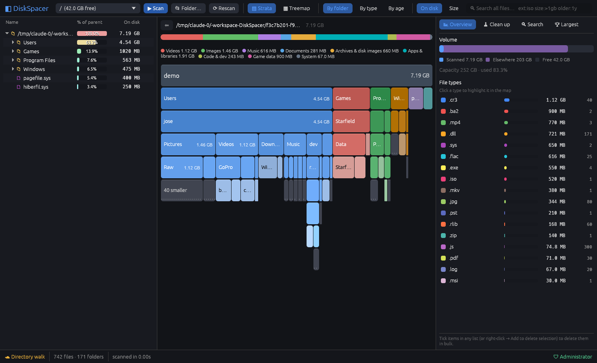

# SizeMatters

A fast Windows disk space analyzer written in Rust. It reads the NTFS **Master File Table** directly, the same technique Everything and WizTree use, so a whole drive with millions of files is indexed in seconds instead of minutes. There is no directory walk.



## Highlights

- **Instant MFT scan.** It reads the NTFS Master File Table straight from the volume (`\\.\C:`) in large sequential reads, parsed in parallel.
  - Sizes are correct for hard links (counted once), sparse, compressed and CompactOS/WOF files (alternate streams are counted), cloud placeholders, resident files and `$BadClus`.
  - Without administrator rights, or on non-NTFS drives, it falls back to a parallel folder walk.
- **Live updates.** After an MFT scan, SizeMatters follows the NTFS change journal, as Everything does. New, deleted, renamed, moved and resized files show up within about 2 seconds, with no rescan.
- **Strata view (default).** The drive is one bar split into coloured blocks, one per folder, and each row splits the block above it.
  - Labels are readable and the zoom is animated.
  - Small items are merged into a "N smaller" block, and free space is shown.
  - Selecting a folder in the tree moves the chart to follow it.
  - Colour by folder, by kind of file, or by age.
- **Treemap view** with cushion shading, plus a phone-style **storage bar** showing what kind of data fills each folder.
- **Everything-style search** across the whole drive: `ext:mp4;mkv size:>500mb`, `older:2y ext:zip`, `folder: node_modules`, `regex:^IMG_\d+`.
- **Clean up.** Select files in a folder and its subfolders by name pattern or regex, extension, size, or created/modified/accessed date. Presets cover temp files, big files, old files, videos, installers and build folders.
- **Duplicate finder.** Files are grouped by size, then checked with a quick head/tail hash, then a full hash, so only likely duplicates are read. One click selects every copy except the newest, the oldest or the one with the shortest path.
- **Changes ("what grew").** Every scan is kept automatically (the last 5 per location), so you can compare with an earlier scan and see which folders and files grew, shrank, appeared or disappeared. You can also save a scan to a `.smscan` file and open it later.
- **Compare folders (a light WinMerge).** It diffs an original and a newer folder and marks each item **new**, **deleted** or **edited**.
  - Comparison uses size and date, or optionally file contents.
  - Copy selected items in either direction with timestamps preserved, or delete them.
  - There is a line-by-line text diff with collapsed context.
- **Remote Linux over SSH.** Scan a server's folders from Windows or Linux.
  - The listing is one streamed, compressed `find` command, with no per-file round trips.
  - Host keys are checked against `known_hosts`: new hosts must be confirmed by fingerprint, and changed keys are refused.
  - Sign in with a password or a key.
  - Search, filter and delete on the server work as they do locally. Remote deletes are permanent, and Linux system paths are protected.
- **Bulk delete, done safely.**
  - The Recycle Bin is the default; permanent delete needs a confirmation.
  - Protected locations are refused (drive root, `Windows`, `Program Files`, user profiles, `/usr`, `/etc`, …).
  - Junctions and symlinks are never followed.
  - Every item is re-checked before deletion.
  - The view updates in place without a rescan.
- **Remote Desktop friendly.** Over RDP it switches to a CPU renderer that redraws only the parts of the window that changed.

## Build

```bash
cargo build --release
```

Cross-compile the Windows exe from Linux:

```bash
rustup target add x86_64-pc-windows-gnu   # plus: apt install mingw-w64
cargo build --release --target x86_64-pc-windows-gnu
```

CI (`.github/workflows/build.yml`) builds and tests on Windows and uploads `sizematters.exe` as an artifact.

## Usage

- Run `sizematters.exe`, pick a drive and click **Scan**. Run it as administrator for the instant MFT scan.
- `sizematters.exe D:\` starts scanning a drive or folder right away.
- `sizematters.exe --cli C:` runs a headless scan and prints timings and the largest items (handy for benchmarking). It also accepts an NTFS image file.
- `sizematters.exe --cli ssh://user@host/path` scans a remote host from the command line. Set `SIZEMATTERS_SSH_PASSWORD` or pass `--key`.
- `sizematters.exe --compare <left> <right>` opens straight into a folder comparison.
- `--software` or `--gpu` forces a renderer, and F12 shows frame timings.

| Shortcut | Action |
|---|---|
| Ctrl+F | Search |
| Enter / double-click | Zoom into folder |
| Backspace, Alt+↑, mouse back | Zoom out |
| ↑ ↓ ← → | Navigate the tree |
| Del / Shift+Del | Recycle / delete permanently |

## Layout

| Path | What |
|---|---|
| `src/scan/mft.rs` | Raw NTFS MFT reader (generic over `Read + Seek`, tested against a real NTFS image in `tests/fixtures`) |
| `src/scan/walk.rs` | Parallel directory-walk fallback |
| `src/live.rs` | NTFS change-journal (USN) watcher and in-place tree updates |
| `src/remote.rs` | SSH client: host-key checking, streamed remote listing, remote delete |
| `src/compare.rs` | Folder diff, copy, text diff |
| `src/dupes.rs` | Duplicate finder |
| `src/snapshot.rs` | Saved scans, history, "what grew" |
| `src/swrender.rs` | CPU renderer with partial redraws for Remote Desktop |
| `src/model.rs` | Compact flat tree (CSR child arrays, string arena) |
| `src/filter.rs` | Search query language and filter engine |
| `src/delete.rs` | Deletion planning, protection rules, execution |
| `src/ui/` | egui app: strata, treemap, tables, panels |
